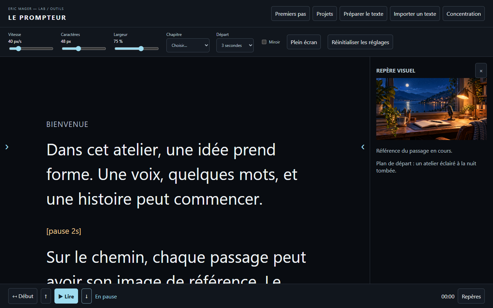

# Guide illustré — LE PROMPTEUR

*Capture de la préversion locale avec les images d’exemple : le texte se lit à gauche et l’image du passage se trouve à droite.*

## Préparer sa lecture

1. Clique sur **Préparer le texte**. Colle le texte dans la grande zone ou utilise **Importer un texte** pour choisir un fichier `.txt` en UTF-8.
2. Laisse une ligne vide entre chaque paragraphe. Pour créer un chapitre, écris son titre sur une ligne séparée en commençant par `## `.
3. Sur une ligne séparée, écris par exemple `[pause 2s]` pour introduire une pause de deux secondes. Une indication comme `[sourire]` s’affiche comme un repère coloré, à ne pas prononcer.
4. Clique sur **Utiliser ce texte**, règle la vitesse, la taille, la largeur et le délai de départ, puis clique sur **Lire**.
5. Pour reprendre une prise, mets en pause et utilise les flèches jusqu’au passage voulu. Le menu **Chapitre** permet aussi de rejoindre un titre.

## Ajouter ses images

1. Ouvre **Préparer le texte**, puis déplie **Studio · prises et repères visuels**.
2. Dans **Passage**, choisis le paragraphe à illustrer.
3. Dans **Référence visuelle**, choisis une image PNG, JPEG, WebP ou GIF de 5 Mo au maximum. Son aperçu apparaît dans la fenêtre.
4. Dans **Note de prise ou de montage**, ajoute si tu le souhaites ce qui doit être retenu pour ce passage.
5. Ferme la fenêtre puis active **Repères** si le panneau est masqué. Pendant la lecture, il présente l’image et la note associées au passage courant.

Il est possible de placer une image sur chaque passage. Le projet de découverte fournit trois exemples originaux : atelier, chemin et voyage. Ils illustrent le fonctionnement et ne sont pas des images de l’épisode 002.

## Après avoir modifié le texte

Un passage inchangé et unique garde ses repères s’il a été déplacé. Quand son texte a changé, ou lorsque plusieurs passages sont identiques et créent une ambiguïté, ses images et notes ne sont pas rattachées au hasard. Retrouve-les dans **Studio → Repères à réassocier**, choisis le nouveau passage puis clique sur **Associer au passage choisi**. Vérifie les associations avant ta prise.

## Garder une copie

Dans **Projets**, nomme et enregistre ton projet dans le navigateur. Utilise aussi **Exporter une sauvegarde** pour conserver un fichier `.json` contenant texte, notes et images. L’import d’une sauvegarde crée un nouveau projet. Une sauvegarde est limitée à 30 Mo : réduis la taille de tes images si nécessaire. Effacer les données du navigateur peut supprimer les projets locaux ; conserve tes copies séparément.

La préversion n’est pas encore une version stable et tous les appareils n’ont pas été vérifiés. Les images et textes importés restent sur l’appareil pendant l’utilisation normale.
